# 🗳️ Decentralized E-Voting System (DApp)

<p align="center">
  
</p>

<p align="center">
  <strong>A Secure, Transparent, and Tamper-Proof Electronic Voting Application Powered by Ethereum Smart Contracts & Supabase Hybrid Architecture</strong>
</p>

<p align="center">
  
  
  
  
  
  
  
  
  
</p>

---

## 📌 Table of Contents

- [Overview & Vision](#-overview--vision)
- [System Architecture](#-system-architecture)
- [Key Features](#-key-features)
- [Smart Contract State Machine](#-smart-contract-state-machine)
- [End-to-End Visual Walkthrough](#-end-to-end-visual-walkthrough)
  - [1. Voter Experience](#1-voter-experience)
  - [2. Election Commission Admin Experience](#2-election-commission-admin-experience)
- [Technology Stack](#-technology-stack)
- [Project Directory Structure](#-project-directory-structure)
- [Prerequisites & Environment Setup](#-prerequisites--environment-setup)
- [Local Installation & Quickstart](#-local-installation--quickstart)
- [MetaMask & Ganache Configuration](#-metamask--ganache-configuration)
- [Database Schema (Supabase)](#-database-schema-supabase)
- [Default Demo Credentials](#-default-demo-credentials)
- [Academic Context & Credits](#-academic-context--credits)

---

## 🌟 Overview & Vision

Traditional voting systems—both paper-based ballots and centralized electronic voting machines (EVMs)—suffer from critical vulnerabilities:
- **Centralized Vulnerabilities**: Risk of database manipulation, ballot stuffing, and unauthorized alteration of tallies.
- **Opacity**: Inability for individual voters to verify cryptographically that their ballots were cast and counted accurately.
- **Logistical Complexity & Delays**: Slow manual auditing, geographically confined balloting, and costly administrative overhead.

The **Decentralized E-Voting System** provides an immutable, transparent, and cryptographically verifiable voting platform engineered on top of the **Ethereum Blockchain**. Combining an off-chain identity verification layer (Aadhar KYC & Supabase) with an on-chain decentralized state machine (`Contest.sol`), the dApp guarantees:
1. **One Citizen = One Vote**: Cryptographically enforced at the EVM bytecode level.
2. **Immutable Ballots**: Zero central authority or rogue administrator can alter cast votes.
3. **Transparent Auditing**: Anyone can inspect public tallies and verification states on-chain in real-time.
4. **Voter Privacy**: Separation of real-world identity records from cryptographic public keys.

---

## 🏗️ System Architecture

The dApp employs a **Hybrid Web3 / Web2 Architecture** balancing cryptographic security with rapid user verification:

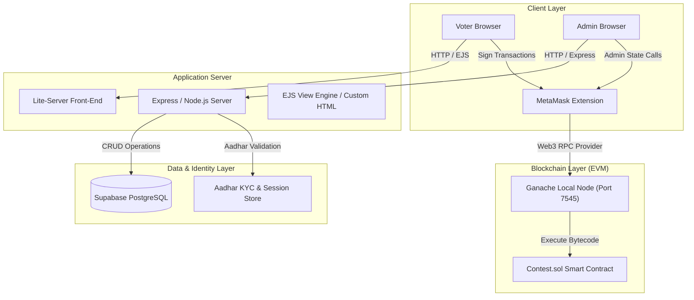

### 🔄 End-to-End Workflow Architecture Diagram

<p align="center">
  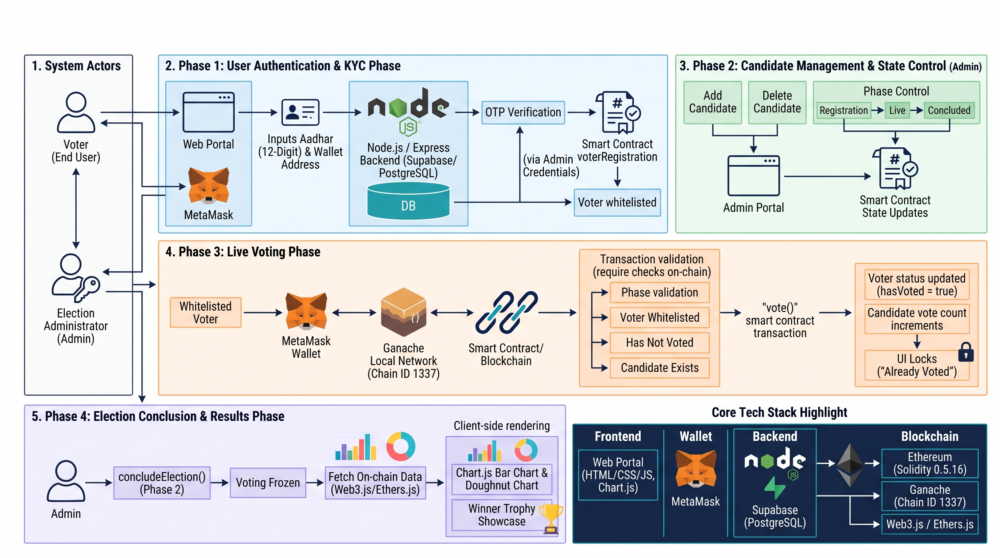
</p>

---

## ⚡ Key Features

| Category | Feature | Description |
| :--- | :--- | :--- |
| **Authentication** | **Dual-Tier Role Separation** | Distinct sign-in portals and authorization paths for regular voters vs. the Election Commission. |
| **KYC Verification** | **Aadhar + Wallet Whitelisting** | Citizen input validation against database records; approved addresses are submitted to the smart contract whitelist. |
| **Integrity** | **Anti-Double-Voting** | Smart contract tracks `voters[msg.sender].hasVoted`; subsequent ballot submissions revert automatically. |
| **State Governance** | **Phased State Machine** | Dynamic election lifecycles (`Registration` ➡️ `Voting` ➡️ `Done`) toggled on-chain by the Election Commission. |
| **Administration** | **Candidate Management** | Admins can add candidates with metadata (name, party, age, qualification) and delete candidates if necessary. |
| **Analytics** | **Real-Time Visualizations** | Interactive **Chart.js** bar charts, donut vote-share distributions, and sorted standings tables. |
| **Web3 UX** | **Deep MetaMask Integration** | Automatic chain ID detection (`1337`), network switch alerts, balance monitoring, and instant account synchronization. |

---

## 🔄 Smart Contract State Machine

The core contract (`contracts/Contest.sol`) enforces strict lifecycle transitions:

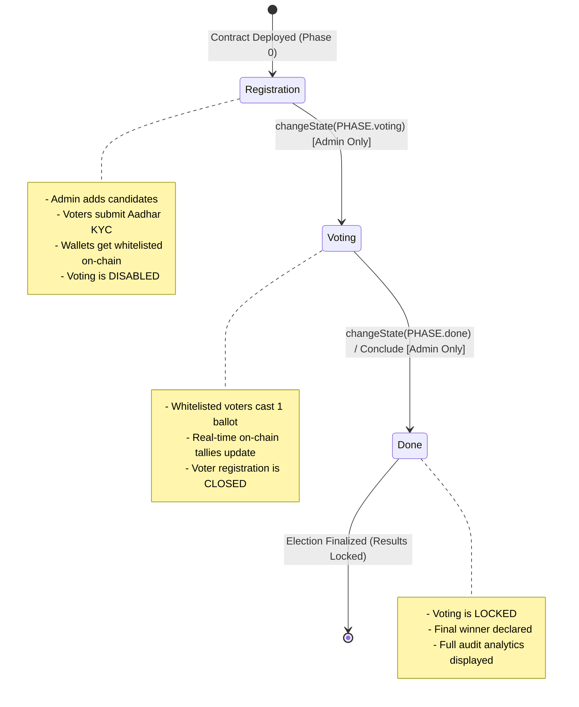

---

## 📸 End-to-End Visual Walkthrough

### 1. Voter Experience

#### Step 1: Main Landing Portal
The centralized gateway allowing voters and election administrators to access their dedicated portals.
<p align="center">
  
</p>

#### Step 2: Voter Registration & Sign-Up
New voters create a secure account with full name, email, and password.
<p align="center">
  
</p>

#### Step 3: Voter Dashboard & Election Manual
Comprehensive orientation detailing election rules, age criteria (18+), Aadhar verification steps, and balloting procedures.
<p align="center">
  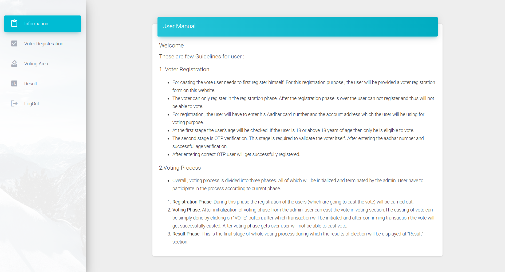
</p>

#### Step 4: Aadhar KYC & Ethereum Wallet Whitelisting
Voters input their 12-digit Aadhar number and link their active Ethereum wallet address with a single-click "USE CONNECTED WALLET" button or demo presets.
<p align="center">
  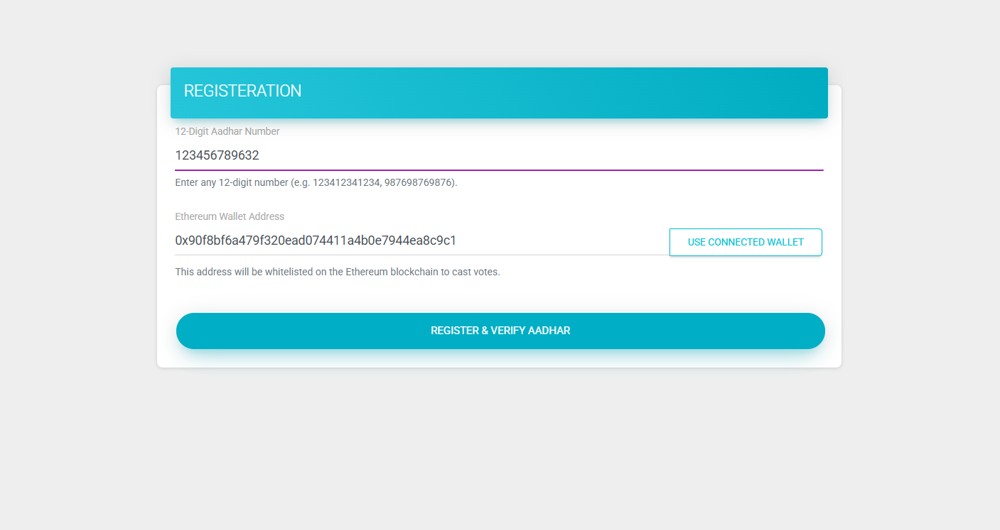
</p>

#### Step 5: On-Chain Whitelisting Confirmation
Instant confirmation verifying that the user's wallet address has been whitelisted on the Ethereum blockchain.
<p align="center">
  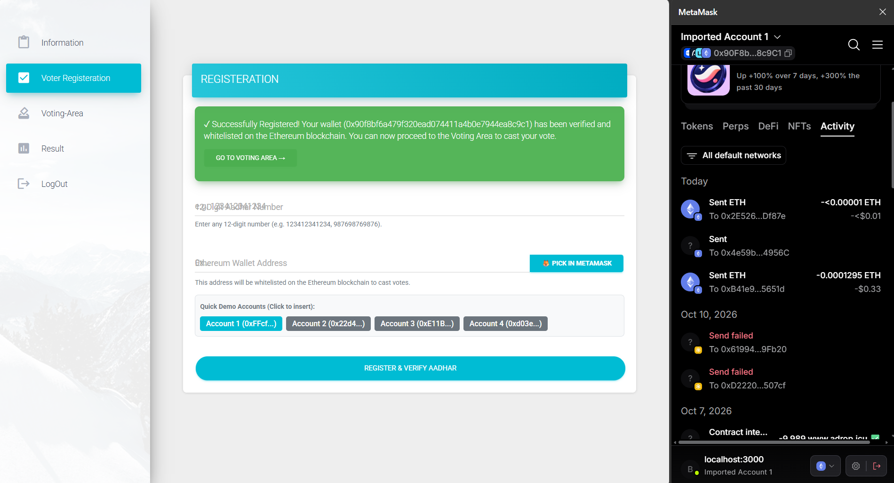
</p>

#### Step 6: Live Ballot Screen
The voter enters the voting booth. If the wallet is whitelisted and the election is in **Phase 1 (Live)**, interactive candidate cards are displayed with full qualifications.
<p align="center">
  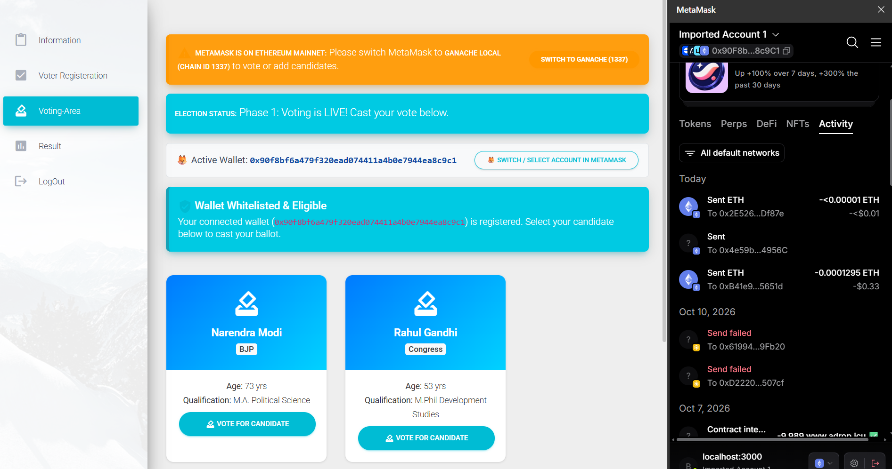
</p>

#### Step 7: MetaMask Web3 Transaction Authorization
The voter clicks "Vote for Candidate". A confirmation modal appears, prompting the voter to cryptographically sign the zero-value Ethereum transaction via MetaMask.
<p align="center">
  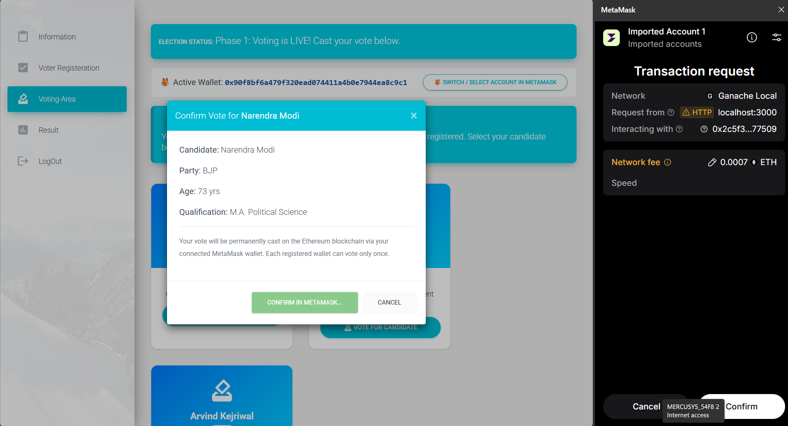
</p>

#### Step 8: Tamper-Proof Vote Receipt & Locked State
Once the block is mined on Ganache, the UI automatically locks further voting attempts, updates the green receipt badge ("YOUR VOTED CANDIDATE"), and prevents double voting.
<p align="center">
  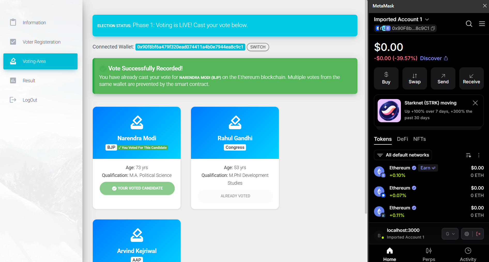
</p>

---

### 2. Election Commission Admin Experience

#### Step 1: Secure Admin Authentication
Administrative portal protected by dedicated credentials to ensure exclusive access to governance features.
<p align="center">
  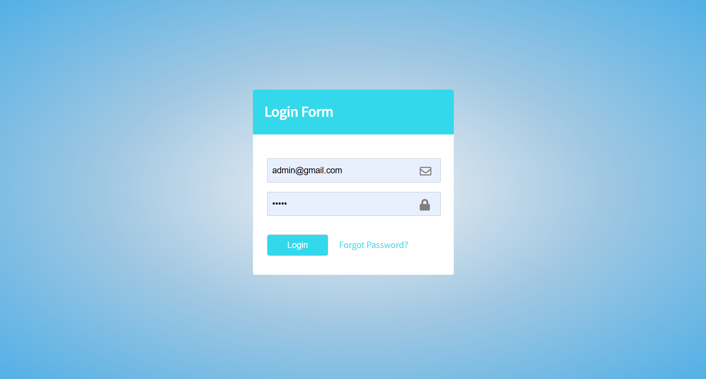
</p>

#### Step 2: Admin Dashboard & Candidate Overview
Real-time KPI metric cards displaying current election phase, active candidates, on-chain votes cast, and registered voter turnout percentage.
<p align="center">
  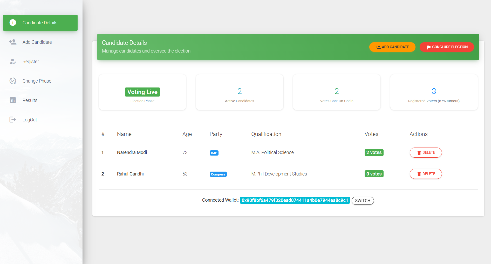
</p>

#### Step 3: Adding Candidates On-Chain
Election officers add candidate credentials (Name, Party, Age, Qualification) directly to the smart contract via MetaMask transactions.
<p align="center">
  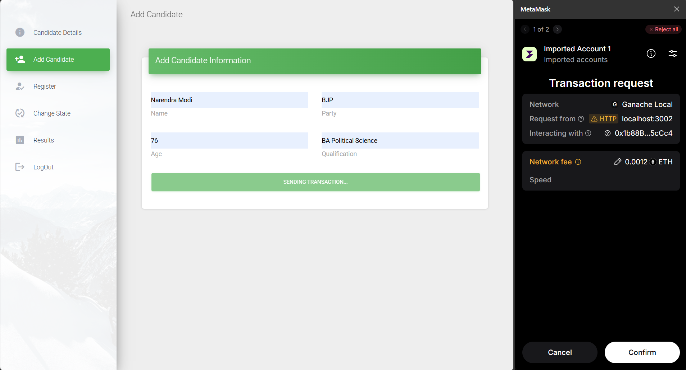
</p>

#### Step 4: Voter Database Verification & Blockchain Whitelisting
The admin reviews incoming voter registration requests, cross-references database status, and authorizes addresses onto the blockchain whitelist.
<p align="center">
  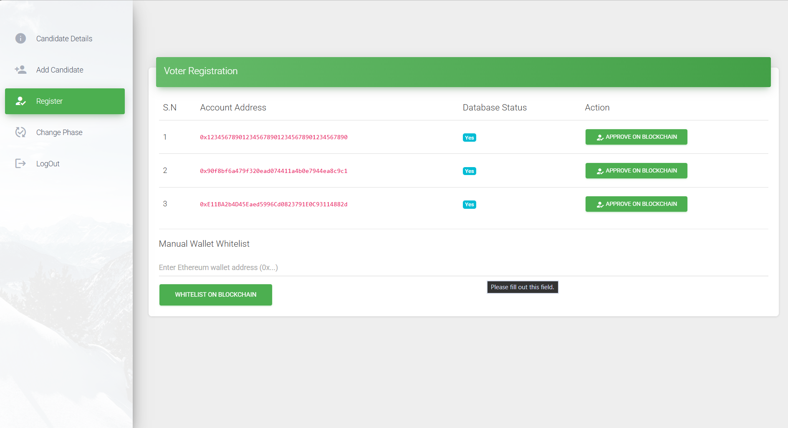
</p>

#### Step 5: Smart Contract Phase State Machine Transitions
Admin controls the election lifecycle, advancing from registration phase to live voting, and concluding the election when polling closes.
<p align="center">
  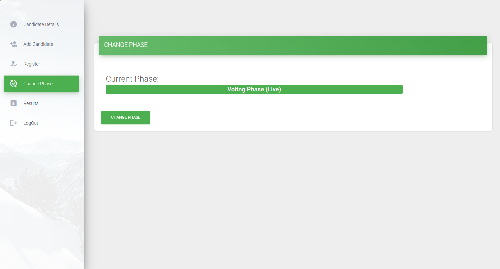
</p>

#### Step 6: Interactive Election Analytics & Results
Live graphical visualization of voting patterns:
- **Bar Chart**: Direct vote tallies per candidate.
- **Donut Chart**: Vote percentage share.
- **Ranked Standings Table**: Sorted breakdown with candidate details and total votes.
<p align="center">
  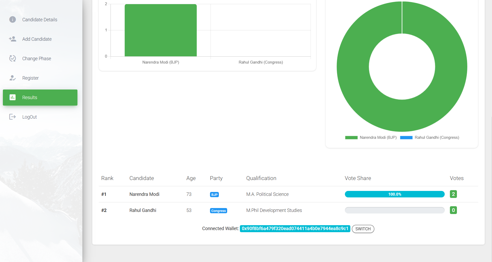
</p>

---

## 🛠️ Technology Stack

| Layer | Technology | Version | Purpose |
| :--- | :--- | :--- | :--- |
| **Smart Contracts** | **Solidity** | `^0.5.16` | Smart contract programming language for ballot logic |
| **Development Suite** | **Truffle** | `^5.11.5` | Contract compilation, automated testing, and migration |
| **Local Blockchain** | **Ganache** | `^7.9.2` | Local Ethereum EVM provider running on port `7545` |
| **Web3 Client** | **Web3.js** | `^1.10.0` | JavaScript interface for interacting with smart contracts |
| **Wallet Provider** | **MetaMask** | Browser Ext | Injected Ethereum provider for signing transactions |
| **Server Runtime** | **Node.js** | `18.x / 20.x` | JavaScript backend execution runtime |
| **Web Framework** | **Express.js** | `^4.17.1` | REST APIs, route handling, and middleware |
| **Database** | **Supabase PostgreSQL** | Cloud / PG 15 | Off-chain voter registry, Aadhar records, and auth storage |
| **Templating** | **EJS & HTML5** | `^3.1.6` | Dynamic server-side rendering and responsive dashboards |
| **Data Visualization**| **Chart.js** | `^2.9.4` | Interactive on-chain vote distribution charts |

---

## 📂 Project Directory Structure

```text
E--Voting-System/
├── contracts/
│   ├── Contest.sol                   # Core Ethereum Smart Contract
│   └── Migrations.sol                # Truffle migration registry
├── migrations/
│   ├── 1_initial_migration.js        # Deploy Migrations contract
│   └── 2_deploy_contracts.js         # Deploy Contest.sol contract
├── routes/
│   └── main.js                       # Express routing & controller logic
├── src/
│   ├── css/                          # Stylesheets & responsive layouts
│   ├── js/
│   │   ├── app.js                    # Web3.js application client logic
│   │   └── material-dashboard.js     # Admin dashboard interactions
│   ├── views/
│   │   └── dashboard.ejs             # Dynamic voter portal template
│   ├── adminCandidateDetails.html    # Admin candidate control panel
│   ├── adminResults.html             # Election analytics & Chart.js view
│   ├── adlogin.html                  # Admin login portal
│   ├── index.html                    # Main landing page
│   ├── login.html                    # Voter sign-in page
│   ├── register.html                 # Voter sign-up page
│   └── registration.html             # Voter Aadhar KYC registration
├── docs/
│   └── screenshots/                  # Curated visual walkthrough assets (16 images)
├── database.js                       # Supabase client & pool connection handler
├── deploy_contract.js                # Direct Web3 deployment script
├── supabase_migration.sql            # SQL schema & initial table creation
├── bs-config.js                      # BrowserSync / Lite-server configuration
├── truffle-config.js                 # Network settings (port 7545, chain 1337)
├── package.json                      # Project dependencies & npm scripts
├── .env.example                      # Sanitized environment configuration
└── README.md                         # Project documentation
```

---

## ⚙️ Prerequisites & Environment Setup

Before running the project locally, ensure the following software is installed:

1. **Node.js**: `v16.x` to `v20.x` ([Download Node.js](https://nodejs.org/))
2. **MetaMask**: Browser extension for Chrome/Brave/Firefox ([Download MetaMask](https://metamask.io/))
3. **Ganache**: Either Ganache GUI or Ganache CLI ([Truffle Suite](https://trufflesuite.com/ganache/))
4. **Git**: Version control tool ([Download Git](https://git-scm.com/))

Install Truffle globally:
```bash
npm install -g truffle
```

---

## 🚀 Local Installation & Quickstart

### Step 1: Clone the Repository
```bash
git clone https://github.com/Nexus2005/E--Voting-System.git
cd E--Voting-System
```

### Step 2: Install Project Dependencies
```bash
npm install
```

### Step 3: Configure Environment Variables
Create a `.env` file in the project root based on `.env.example`:
```bash
cp .env.example .env
```
Update your credentials in `.env`:
```env
SUPABASE_URL="https://your-project.supabase.co"
SUPABASE_ANON_KEY="your-anon-key"
SUPABASE_SERVICE_ROLE_KEY="your-service-role-key"

PG_HOST="aws-0-ap-southeast-2.pooler.supabase.com"
PG_PORT="5432"
PG_USER="postgres.your-project"
PG_PASSWORD="your-secure-password"
PG_DATABASE="postgres"
```

### Step 4: Launch Ganache Local Blockchain
Start Ganache on port `7545` with Network ID `5777` and Chain ID `1337`:
```bash
npx ganache --port 7545 --networkId 5777 --chainId 1337
```
*(Leave this terminal running in the background).*

### Step 5: Compile & Deploy Smart Contracts
In a new terminal window, compile the Solidity contracts and deploy them to Ganache:
```bash
truffle compile
truffle migrate --reset
```
*Alternatively, you can run the direct deployment script:*
```bash
node deploy_contract.js
```

### Step 6: Start the Application Server
Start the Express server and lite-server interface:
```bash
npm run dev
```
The application will launch automatically at:
```text
http://localhost:3000
```

---

## 🦊 MetaMask & Ganache Configuration

To allow MetaMask to interact with your local blockchain:

### 1. Add Local Network to MetaMask
- Open MetaMask ➡️ Click **Network Selector** ➡️ **Add Network** ➡️ **Add a network manually**.
- **Network Name**: `Ganache Local`
- **New RPC URL**: `http://127.0.0.1:7545`
- **Chain ID**: `1337`
- **Currency Symbol**: `ETH`
- Click **Save**.

### 2. Import Ganache Accounts
- Open Ganache and copy the **Private Key** of `Account 0` (used as the deployer/admin account).
- In MetaMask, click on your profile icon ➡️ **Import Account** ➡️ Paste the private key.
- Repeat for `Account 1` and `Account 2` to test voter accounts with pre-funded local ETH.

---

## 🗄️ Database Schema (Supabase)

The off-chain voter database is managed using Supabase PostgreSQL. Execute the following schema inside your Supabase SQL Editor:

```sql
-- Voters table for user authentication
CREATE TABLE IF NOT EXISTS users (
    id SERIAL PRIMARY KEY,
    name VARCHAR(255) NOT NULL,
    email VARCHAR(255) UNIQUE NOT NULL,
    password VARCHAR(255) NOT NULL,
    created_at TIMESTAMP WITH TIME ZONE DEFAULT CURRENT_TIMESTAMP
);

-- Registered voters for KYC and wallet whitelisting
CREATE TABLE IF NOT EXISTS registered_users (
    id SERIAL PRIMARY KEY,
    aadhar_number VARCHAR(12) UNIQUE NOT NULL,
    account_address VARCHAR(42) UNIQUE NOT NULL,
    is_approved BOOLEAN DEFAULT TRUE,
    created_at TIMESTAMP WITH TIME ZONE DEFAULT CURRENT_TIMESTAMP
);

-- Administrator credentials
CREATE TABLE IF NOT EXISTS admin (
    id SERIAL PRIMARY KEY,
    email VARCHAR(255) UNIQUE NOT NULL,
    password VARCHAR(255) NOT NULL
);

-- Default admin insert
INSERT INTO admin (email, password)
VALUES ('admin@gmail.com', 'admin')
ON CONFLICT (email) DO NOTHING;
```

---

## 🔑 Default Demo Credentials

For testing and demonstration purposes:

| Role | Email / ID | Password | Access Rights |
| :--- | :--- | :--- | :--- |
| **Admin (Election Commission)** | `admin@gmail.com` | `admin` | Candidate management, phase transitions, voter approvals, election conclusion |
| **Voter Account 1** | `voter1@gmail.com` | `Voter@123` | Voter registration, Aadhar KYC, balloting, live receipt viewing |
| **Demo Aadhar Numbers** | `123412341234`, `987698769876` | N/A | 12-digit standard test identifiers |

---

## 🎓 Academic Context & Credits

This project was conceived and engineered as part of the **Blockchain Technology & Decentralized Applications** curriculum at:

<p align="center">
  <strong>MET's Institute of Engineering, Nashik</strong><br/>
  <em>Department of Computer Engineering</em>
</p>

- **Lead Developer**: Omkar Ahirrao ([@Nexus2005](https://github.com/Nexus2005))
- **Domain**: Blockchain Technology, Smart Contract Engineering, Web3 Security, Distributed Systems.

---

<p align="center">
  <sub>Built with ❤️ for decentralized, transparent, and democratic governance.</sub>
</p>
